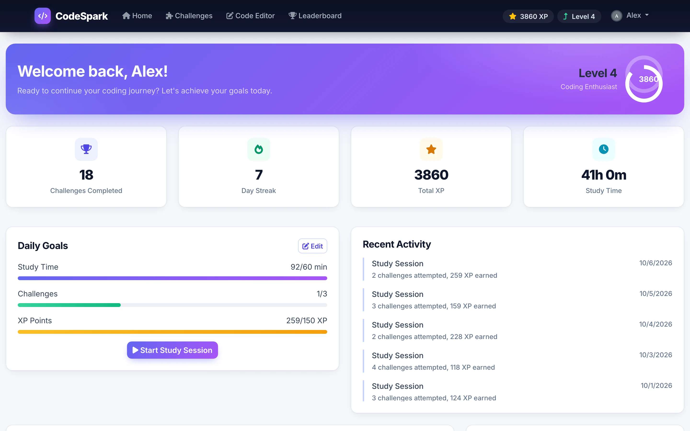
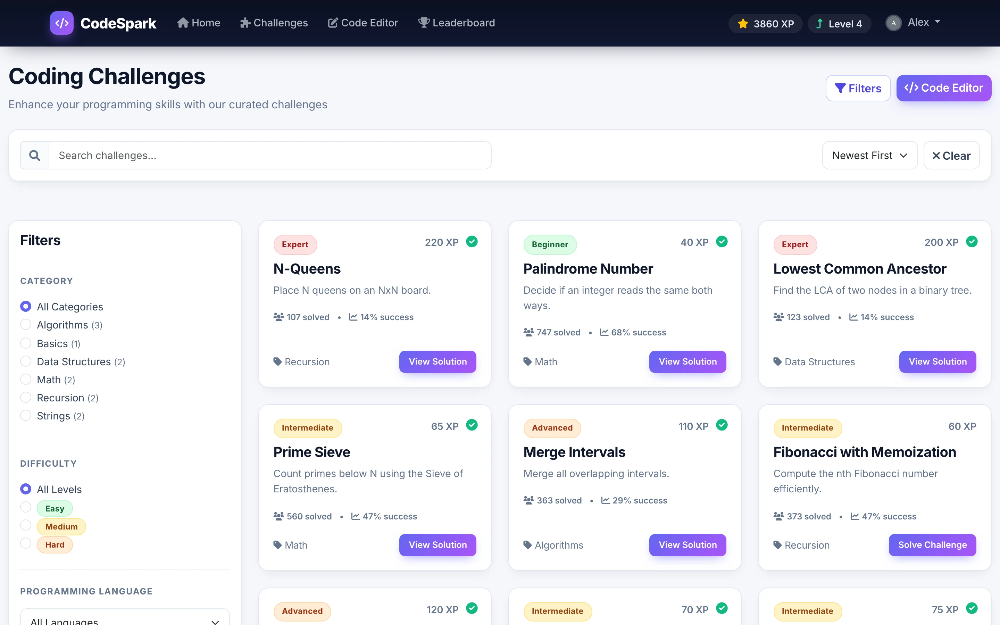
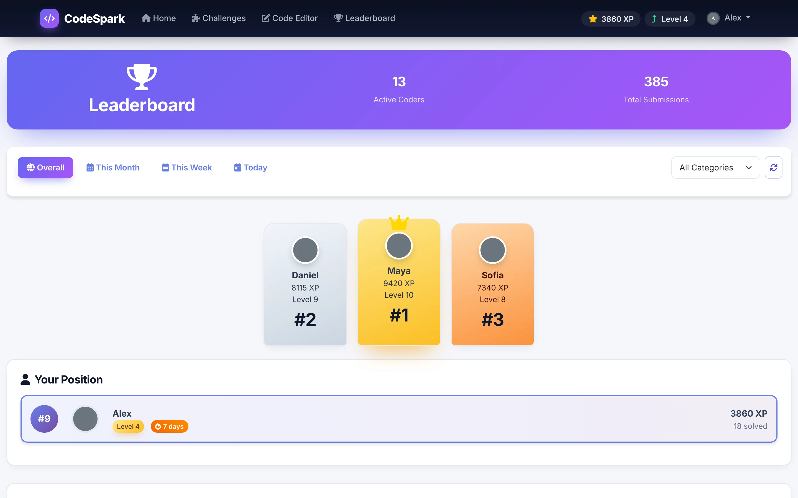
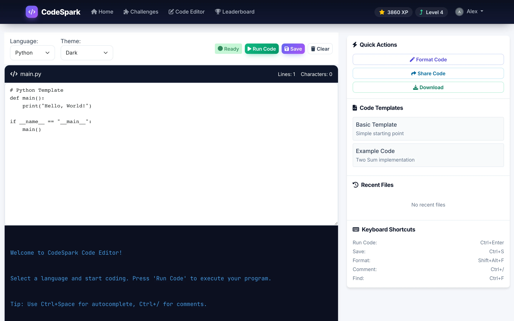
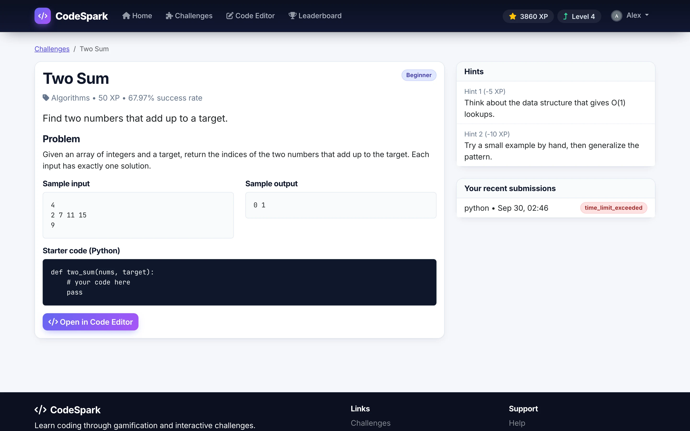
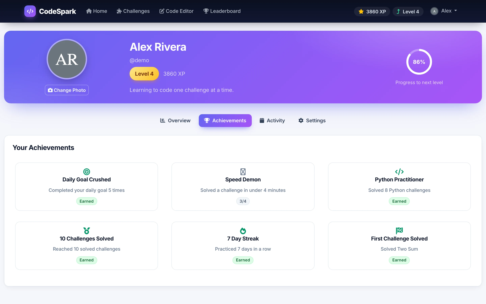
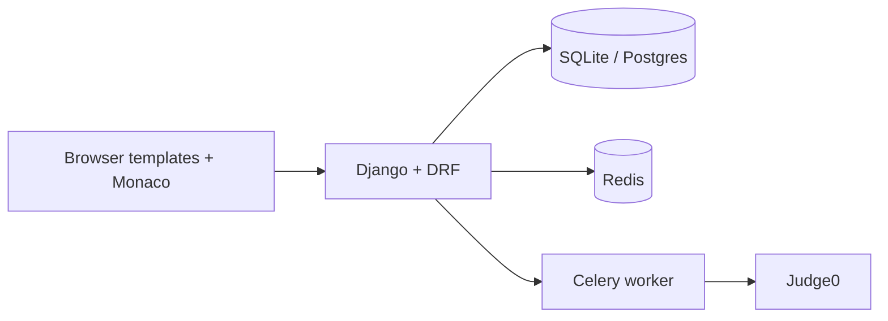

# Code-Spark

**A gamified coding-practice platform: solve challenges in a browser editor, earn XP, build streaks and climb a leaderboard.**

Python · Django · Django REST Framework · Celery · Redis · Judge0 · Bootstrap

<table>
  <tr>
    <td></td>
    <td></td>
  </tr>
  <tr>
    <td></td>
    <td></td>
  </tr>
</table>
Screenshots are real captures of a local build running on fictional demo data.

---

## Product at a Glance

| | |
|---|---|
| **What it is** | Coding-practice platform in the spirit of a lightweight LeetCode, with a progression layer |
| **Users** | Learners solving programming challenges; admins manage content through Django admin |
| **Gamification** | XP, levels, streaks, badges and achievements, daily goals, leaderboard |
| **Execution** | Code is submitted to a Judge0 service through a Celery task |
| **Auth** | Email accounts, optional Google and GitHub sign-in (django-allauth), JWT for API calls |
| **Data** | SQLite by default, Postgres through `DATABASE_URL`; Redis for cache and Celery broker |

## Product Showcase

<table>
  <tr>
    <td align="center"> <b>Challenge detail</b> Problem, samples, hints, history</td>
    <td align="center"> <b>Achievements</b> Earned and in-progress badges</td>
    <td align="center"> <b>Dashboard</b> Level, streak, daily goals</td>
  </tr>
</table>

## Key Features

- **Challenge library.** Categories, difficulty levels, search and filters, a detail page with hints and recent submissions.
- **Browser code editor.** Monaco-based editor with language and theme selection and templates.
- **Asynchronous execution.** Submissions are queued; a Celery task sends code to Judge0 and stores the result.
- **Progression.** XP and levels, solve streaks, badges, achievements and optional daily goals.
- **Leaderboard.** Ranked users with a podium and a "your position" card.
- **Profile.** Stats, recent submissions, achievements and settings.
- **Admin.** Django admin for challenges, users, badges and execution records.

## Architecture

Server-rendered Django templates call a DRF API with a JWT bearer token. Four apps (accounts, challenges, progress, executor) separate the domains. Execution is handed to Celery, which talks to Judge0 and updates the database.

Details: [docs/ARCHITECTURE.md](docs/ARCHITECTURE.md).

## Engineering Highlights

- Domain-separated Django apps: accounts, challenges, progress, executor.
- Gamification modelled in the schema (XP, level, streak, badges, daily goals) rather than a separate engine.
- Execution queue and retry models for Judge0 submissions, with Celery tasks handling polling.
- Combined session and JWT authentication, with allauth for social sign-in.
- Docker, nginx and gunicorn configuration files and a health endpoint.

## Status & Scope

- The screenshots come from a local demo build seeded with fictional users, challenges and submissions; a one-click demo login is enabled only by an environment flag.
- Running the demo required small fixes to mismatches between views, serializers and models, plus a few missing front-end assets.
- **Run Code was not exercised in the demo:** it needs a Judge0 service, which was not available, so no execution results are shown.
- The WebSocket layer (Channels) is scaffolded but not active. There is no AI or LLM feature.
- No load testing has been performed.

## Documentation

| Read | For |
|---|---|
| [Technical case study](docs/TECHNICAL_CASE_STUDY.md) | End-to-end write-up |
| [Architecture](docs/ARCHITECTURE.md) | Apps, models and flows |
| [Engineering challenges](docs/ENGINEERING_CHALLENGES.md) | Problems, approaches, trade-offs |
| [Product overview](docs/PRODUCT_OVERVIEW.md) | Features and user flow |
| [Privacy and source](docs/PRIVACY_AND_SOURCE.md) | What is and is not published |

## Source Code

This repository is a portfolio showcase. Production source code is maintained privately. See [RIGHTS.md](RIGHTS.md) for usage terms.
