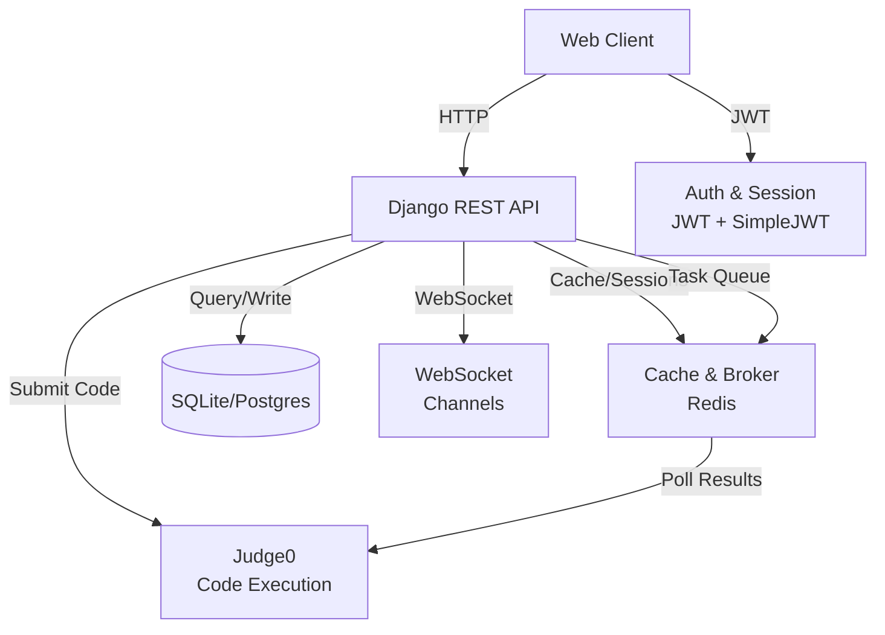

# Architecture

All diagrams are original and conceptual. They describe responsibilities, not production class or file names.

## System overview

## App structure

Code-Spark is organized as a monolithic Django project split into semantic apps:

- **accounts.** User model (email-based, no username), authentication endpoints, user statistics (XP, level, badge counts), and leaderboard queries.
- **challenges.** Challenge categories, problem statements, test cases, hints, and challenge detail/list views.
- **progress.** User progress tracking: XP ledger, level calculation, streaks, daily goals, study session history, and achievement/badge models.
- **executor.** Judge0 integration: environment setup, submission queue, Celery task workers for async execution and result polling, execution metrics logging.
- **api.** DRF viewsets, serializers, and URL routing under `/api/v1/`.

Frontend pages render templates hitting REST endpoints with JWT Bearer authorization from `localStorage`.

## Data model

- **User:** Email-based account with XP, level, created timestamp.
- **Challenge:** Problem statement, category, difficulty, test cases.
- **Submission:** User code, status (accepted/failed/error), XP earned.
- **UserProgress:** Challenges solved, current and longest streak, last solved date.
- **Achievement/Badge:** Badge unlocks at XP milestones; users earn badges.
- **DailyGoal:** User-set daily challenge target, tracked per date.

## Execution flow

1. User submits code via the editor.
2. REST endpoint accepts submission and enqueues a Celery task.
3. Task sends code to Judge0 with the problem's test cases and waits for completion.
4. Judge0 compiles, runs, and returns test results (passed/failed/runtime error).
5. Task updates submission record with status and XP earned.
6. Frontend polls or waits for WebSocket notification (scaffolded but optional).
7. Dashboard and profile refresh to reflect new XP and level.

## Technologies

- **Backend.** Django 4.2, Django REST Framework, SimpleJWT for JWT tokens.
- **Authentication.** django-allauth for social sign-in (Google, GitHub), custom email user model.
- **Async tasks.** Celery + Redis for background execution queue and result polling.
- **Database.** SQLite for development; Postgres via `DATABASE_URL` in production.
- **Frontend.** Server-rendered templates (Bootstrap 5, jQuery), Monaco editor (CDN).
- **WebSocket.** Django Channels (scaffolded, not currently active).
- **Deployment.** Docker (Dockerfile + docker-compose), nginx reverse proxy, gunicorn WSGI server.
- **Code execution.** Judge0 API for compilation and testing.
- **Caching.** Redis for session store and Celery broker.
